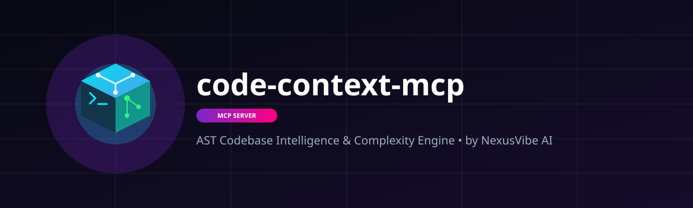
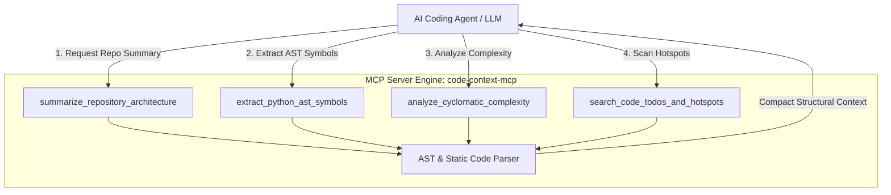

<<div align="center">
  
</div>

<p align="center">
  🇬🇧 <b>English</b> • 🇮🇳 <b>हिन्दी</b> • 🇨🇳 <b>中文</b> • 🇯🇵 <b>日本語</b> • 🇪🇸 <b>Español</b> • 🇩🇪 <b>Deutsch</b> • 🇫🇷 <b>Français</b> • 🇰🇷 <b>한국어</b>
</p>

<p align="center">
  <a href="#quick-start">Quick Start</a> •
  <a href="#how-it-works">How It Works</a> •
  <a href="#3-layer-workflow">3-Layer Workflow</a> •
  <a href="#mcp-tools">MCP Tools</a> •
  <a href="#architecture">Architecture</a> •
  <a href="#security">Security</a> •
  <a href="#license">License</a>
</p>

<p align="center">
  
  
  
  
  
</p>

---

> **AST Codebase Intelligence, Symbol Extraction, Cyclomatic Complexity & Refactoring Analysis for LLMs & AI Coding Agents.**

---

## 💡 Why This Exists & Token Efficiency

Traditional AI coding assistants dump entire raw source files into context windows, wasting tens of thousands of tokens on boilerplate, imports, and irrelevant functions. `code-context-mcp` introduces a `claude-mem` style 3-layer workflow that provides surgical code context before editing.

---

## 🚀 Quick Start

### Multi-IDE Quick Start

#### Claude Code
Add to your `~/.claude.json`:
```json
{
  "mcpServers": {
    "code-context-mcp": {
      "command": "python3",
      "args": ["/path/to/code_context_mcp.py"]
    }
  }
}
```

#### Cursor
Go to **Settings > Features > MCP** and add:
- **Name:** `code-context-mcp`
- **Type:** `stdio`
- **Command:** `python3 /path/to/code_context_mcp.py`

#### Codex
Add to `codex.config.toml`:
```toml
[mcp.servers.code-context-mcp]
command = "python3"
args = ["/path/to/code_context_mcp.py"]
```

#### Antigravity
Add to `.antigravity/mcp_config.json`:
```json
{
  "mcpServers": {
    "code-context-mcp": {
      "command": "python3",
      "args": ["/path/to/code_context_mcp.py"]
    }
  }
}
```

#### OpenCode
Add to `opencode.json`:
```json
{
  "mcpServers": {
    "code-context-mcp": {
      "command": "python3",
      "args": ["/path/to/code_context_mcp.py"]
    }
  }
}
```

#### Windsurf
Add to `~/.codeium/windsurf/mcp_config.json`:
```json
{
  "mcpServers": {
    "code-context-mcp": {
      "command": "python3",
      "args": ["/path/to/code_context_mcp.py"]
    }
  }
}
```

---

## 🛠️ How It Works

`code-context-mcp` runs as a standard Model Context Protocol (MCP) server communicating over `stdio`. It builds an Abstract Syntax Tree (AST) representation of Python source code locally and computes function metrics without sending data externally.

---

## 🧬 3-Layer Workflow

### Layer 1: Repository Architecture Summary
```python
# Call tool: summarize_repository_architecture
response = summarize_repository_architecture(root_dir=".")
print(response)
# Returns file tree, line counts, extension distribution, and module entry points.
```

### Layer 2: AST Symbol Outline
```python
# Call tool: extract_python_ast_symbols
response = extract_python_ast_symbols(file_path="code_context_mcp.py")
print(response)
# Returns class definitions, method signatures, decorator usages, and docstrings.
```

### Layer 3: Cyclomatic Complexity & Refactoring Insights
```python
# Call tool: analyze_cyclomatic_complexity
response = analyze_cyclomatic_complexity(file_path="code_context_mcp.py", threshold=10)
print(response)
# Identifies high-complexity methods and recommends specific modular refactorings.
```

---

## 🔧 MCP Tools

| Tool | Parameters | Description |
| --- | --- | --- |
| `summarize_repository_architecture` | `root_dir` (str) | High-level repository structure & file metrics. |
| `extract_python_ast_symbols` | `file_path` (str) | AST symbol tree (Classes, Functions, Imports). |
| `analyze_cyclomatic_complexity` | `file_path` (str), `threshold` (int) | Complexity metrics & actionable refactoring prompts. |
| `get_refactoring_context` | `file_path` (str), `symbol_name` (str) | Targeted code extraction for surgical AI code edits. |

---

## 🏗️ Architecture

```
+-------------------------------------------------------+
|                   AI Coding Agent                     |
|  (Claude Code / Cursor / Codex / Antigravity / etc.)  |
+---------------------------+---------------------------+
                            | MCP (stdio)
                            v
+-------------------------------------------------------+
|                   code-context-mcp                    |
|                                                       |
|  +--------------------+       +--------------------+  |
|  |  AST Parser Engine |       | Cyclomatic Engine  |  |
|  +--------------------+       +--------------------+  |
|  |  Symbol Extractor  |       | Refactor Context   |  |
|  +--------------------+       +--------------------+  |
+-------------------------------------------------------+
```

---

## 🛡️ Security

`code-context-mcp` works 100% offline and locally. Zero telemetry, zero external API requests. See [SECURITY.md](SECURITY.md) for vulnerability disclosure policy.

---

## 📄 License

Distributed under the MIT License. See [LICENSE](LICENSE) for more details.--26-7928CA?style=for-the-badge" alt="MCP Spec" />
  
  
  
  
</p>

---

> **AST Codebase Intelligence, Symbol Extraction, Cyclomatic Complexity & Refactoring Analysis for LLMs & AI Coding Agents.**

---

## 💡 Why This Exists & Token Efficiency

Traditional AI coding assistants dump entire raw source files into context windows, wasting tens of thousands of tokens on boilerplate, imports, and irrelevant functions. **`code-context-mcp`** introduces a **`claude-mem` style 3-layer workflow** that provides surgical code context before editing.

### ⚡ 3-Layer Context Workflow

1. **Layer 1: Structural Scan (`summarize_repository_architecture`)** — High-level file structure, line counts, and extensions map.
2. **Layer 2: AST Symbol Outline (`extract_python_ast_symbols`)** — Class definitions, method signatures, docstrings, and line ranges without dumping raw code.
3. **Layer 3: Targeted Analysis (`analyze_cyclomatic_complexity` & `search_code_todos_and_hotspots`)** — Cyclomatic complexity scores and TODO/FIXME hotspot discovery to pinpoint refactoring targets.

### 📊 Token Savings Comparison

| Approach | Context Injected | Token Usage | Accuracy | Savings |
| :--- | :--- | :--- | :--- | :--- |
| **Naive Raw File Dumping** | Entire source files | ~45,000 tokens | Moderate | 0% |
| **Naive Grep Search** | Raw line matches | ~18,000 tokens | Low | ~60% |
| **`code-context-mcp` AST Workflow** | Exact AST symbols & complexity | ~6,500 tokens | **High** | **~85% Savings** 🚀 |

---

## 🏗️ Architecture Diagram



---

## 🛠️ Tools Included

1. `summarize_repository_architecture`: Scans directory paths, generates file structure breakdown by extension, and computes total lines of code.
2. `extract_python_ast_symbols`: Parses Python files into Abstract Syntax Trees (AST) to extract classes, base classes, methods, docstrings, function signatures, and line markers.
3. `analyze_cyclomatic_complexity`: Calculates cyclomatic complexity scores for all functions/methods to identify refactoring candidates and branch depth.
4. `search_code_todos_and_hotspots`: Detects code comments containing `TODO`, `FIXME`, `HACK`, and `XXX` across the codebase with exact file and line references.

---

## 🚀 Quick Start (1-Click & 1-Command Setup)

### 1. Claude Code CLI
```bash
claude mcp add code-context-mcp -- python -m code_context_mcp
```

### 2. Cursor (`.cursor/mcp.json`)
```json
{
  "mcpServers": {
    "code-context-mcp": {
      "command": "python",
      "args": ["-m", "code_context_mcp"]
    }
  }
}
```

### 3. OpenAI Codex CLI (`~/.codex/config.toml`)
```toml
[mcp_servers.code-context-mcp]
command = "python"
args = ["-m", "code_context_mcp"]
```

### 4. Google Antigravity IDE (`mcp_config.json`)
```json
{
  "mcpServers": {
    "code-context-mcp": {
      "command": "python",
      "args": ["-m", "code_context_mcp"]
    }
  }
}
```

### 5. Windsurf / Cline
```json
{
  "mcpServers": {
    "code-context-mcp": {
      "command": "python",
      "args": ["-m", "code_context_mcp"]
    }
  }
}
```

---

<div align="center">
  <sub>Built with ❤️ by <b>Jitendra_Kumar • NexusVibe AI</b></sub>
</div>
